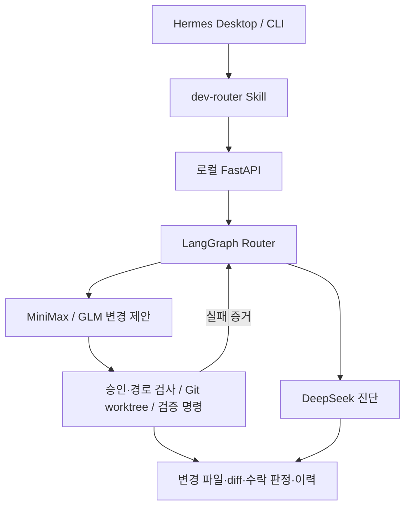

# Hermes Development Router

**Hermes에서 요청한 개발 작업을 명세 승인 → 격리 실행 → 테스트 → 결과 보고까지 연결하는 로컬 개발 Router입니다.**

기존 Hermes Desktop과 CLI를 사용자 인터페이스로 사용하며, Hermes 코어와 기존 Provider 설정을 유지합니다. 작업 실패나 API 오류가 발생하면 MiniMax → GLM → DeepSeek 진단 순서로 대응합니다.

> 현재 이 GitHub 저장소의 공개 내용은 프로그램 안내 문서입니다. 아래 설치·실행 명령은 프로젝트 소스와 스크립트가 준비된 로컬 환경을 기준으로 합니다.

## 주요 기능

| 기능 | 동작 |
| --- | --- |
| 요구사항 분석 | 목표, 기능·비기능 요구사항, 허용 파일, 금지 변경, 수락 기준, 검증 명령, 위험 수준을 구조화 |
| 사용자 승인 | 모호한 부분은 질문하고, 승인한 명세는 버전·해시와 함께 동결 |
| 자동 Provider 전환 | 요구사항 누락, 반복 테스트 실패, 사용량 제한, 복구 가능한 API 오류에 대응 |
| 코드 격리 | 작업별 Git worktree 생성, 원본 저장소와 분리 |
| 변경 정책 | 허용 경로·금지 변경을 검사하고 DB·스키마 등 위험 범위는 사전 승인 요청 |
| 독립 검증 | 모델 응답과 별도로 승인된 모든 검증 명령과 요구사항별 수락 기준 확인 |
| 영구 기록 | SQLite에 작업 상태, 체크포인트, 시도, 전환 이력과 실행 결과 저장 |
| 운영 | 취소, 중단 상태 복구, 로그 회전, 비밀정보 마스킹, 관측 지표 제공 |

실패한 작업의 코드와 diff는 보존합니다. 작업 결과를 main 브랜치에 자동 병합하지 않습니다.

## Provider 실행 방식

| 순서 | Provider / Model | 역할 |
| --- | --- | --- |
| 1 | MiniMax / `MiniMax-M3` | 최초 변경 제안 |
| 2 | GLM / `glm-5.3` | 전환 조건 충족 시 후속 변경 제안 |
| 3 | DeepSeek / `deepseek-v4-pro` | 실패 원인 진단 전용 |

- 같은 검증 실패가 2회 반복되거나 필수 산출물이 누락되면 전환합니다.
- HTTP 429·사용량 제한은 대체 Provider로 넘깁니다.
- 네트워크·일시적 API 오류는 같은 Provider 구간에서 최대 2회 재시도합니다.
- 전체 시도 수와 작업 마감시간을 제한합니다.
- 허용되지 않은 변경은 작업을 중단합니다.
- DeepSeek의 진단 반환을 개발 완료로 처리하지 않습니다.

**모델의 “완료했습니다”라는 응답이나 CLI 종료 코드만으로 성공을 판단하지 않습니다.**

## 구성



주요 기술은 Python, FastAPI, Pydantic, LangGraph, SQLite, Git worktree, Hermes CLI subprocess, pytest입니다.

## 실행 환경

- macOS Apple Silicon
- Python 3.11 이상 — 검증 환경은 Python 3.13.12
- Git, `uv`, 설치된 Hermes CLI
- 실제 호출에 사용할 Provider 인증 정보
- macOS `sandbox-exec`

검증한 Hermes 설치본은 `0.21.7` 계열입니다. Provider ID와 CLI 옵션은 설치본을 조사한 뒤 사용했습니다. 다른 설치본에서는 호환성을 먼저 확인해야 합니다.

## 설치와 시작

**로컬 프로젝트 소스 폴더에서** 실행합니다.

```bash
bash scripts/install.sh --install-skill

# 현재 프로젝트의 실제 절대 경로를 허용 저장소로 등록
export HERMES_ROUTER_ALLOWED_REPOS="$(.venv/bin/python -c 'import json,pathlib; print(json.dumps([str(pathlib.Path.cwd())]))')"

# 실제 Provider 사용 허용
export HERMES_ROUTER_ALLOW_REAL=1

bash scripts/start.sh
```

기본 주소는 `http://127.0.0.1:8080`입니다. 실제 Provider 호출은 해당 서비스의 사용량을 소비합니다. 실제 호출을 허용하지 않으려면 `HERMES_ROUTER_ALLOW_REAL`을 설정하지 않고 Mock 모드로 사용합니다.

설치 스크립트는 프로젝트 전용 가상환경을 준비하고, 선택적으로 사용자 Hermes 홈에 `dev-router` Skill과 CLI 진입점을 추가합니다. 기존 사용자 수정본은 보존합니다.

## Hermes Desktop에서 사용

기본 Hermes 프로필의 새 대화에서 다음과 같이 요청합니다.

> dev-router 스킬을 불러와. 로컬 Router에 연결해서 내가 지정한 저장소의 개발 작업을 준비해 줘. 먼저 요구사항, 허용 파일과 검증 방법을 정리하고 내 승인을 받아.

Desktop에서 로컬 명령 실행 도구를 사용할 수 있어야 합니다. 다른 프로필을 사용하면 해당 프로필에서 Skill이 보이는지 확인합니다.

CLI에서 Skill을 미리 불러올 수도 있습니다.

```bash
hermes chat --skills dev-router
```

개발 작업은 다음 순서로 진행합니다.

1. 요청과 대상 Git 저장소 확인
2. 요구사항 초안 작성 및 누락 항목 질문
3. 명세 버전·해시·변경 범위·검증 명령 검토
4. 사용자 명세 승인
5. 필요한 경우 별도 위험 승인
6. 격리 worktree에서 실행 및 검증
7. 변경 내용·테스트·전환 이력 보고

새 프로젝트는 별도 Git 저장소를 만들고 Router의 허용 목록에 등록합니다.

## 조회와 제어

```bash
dev-router status JOB_ID
dev-router failures JOB_ID
dev-router history JOB_ID
dev-router events JOB_ID
dev-router report JOB_ID
dev-router cancel JOB_ID
dev-router metrics --mode hermes
```

작업용 REST API는 `/v1/jobs`입니다. 명세 작성·승인·시작·취소·위험 승인·복구 및 결과 조회를 지원합니다.

`/health` 이외의 HTTP 경로는 관리자 토큰 인증을 요구합니다. CLI가 로컬 토큰 파일을 내부에서 읽으므로 토큰을 대화나 명령행 값으로 복사하지 않습니다.

## 필요할 때 켜고 끄기

작업할 때 `bash scripts/start.sh`로 실행하고, 작업 완료 후 해당 터미널에서 **Ctrl-C**로 정상 종료합니다. SQLite 기록은 다음 실행에도 유지됩니다.

갑작스러운 프로세스 종료 후에는 미완료 작업을 복구 상태로 보존하며, 부작용 검토와 명시적인 재개 확인을 요구합니다. 기존 마감시간과 시도 예산을 초기화하지 않습니다.

동일한 데이터 디렉터리에는 Router 한 개만 실행합니다. 이미 실행 중이면 기존 서버를 사용하거나 정상 종료한 뒤 재시작합니다. 잠금 파일 삭제로 중복 실행 제한을 우회하지 않습니다.

기본 데이터 위치는 `~/codex/hermes-router/data`이며 `HERMES_ROUTER_DATA_DIR`로 바꿀 수 있습니다. 로그 회전·백업 스크립트와 향후 launchd 구성을 제공합니다. launchd 서비스는 자동 설치하지 않습니다.

## 검증 결과

2026-10-20 로컬 검증 기준입니다.

| 항목 | 결과 |
| --- | --- |
| 자동 테스트 | 208개 통과 |
| 커버리지 | 약 85.7% — branch 포함 |
| 필수 시나리오 | 성공, 요구사항 누락, 반복 실패, GLM 실패 후 진단, 429, 네트워크 재시도, DB 승인, 실제 SIGKILL 복구, 금지 변경, 최대 시도 제한 |
| 실제 개발 검사 | MiniMax 첫 시도 수락 검사 통과, 전체 약 41.93초 |
| 독립 QA | GLM 5.3 핵심 7개 파일 집중 정적 검토 통과 |
| Skill | Hermes 등록·활성화 확인 |
| launchd 구성 | plist 문법 검사 통과 |

전체 자동 테스트는 로컬 harness가 실행했습니다. GLM이 모든 파일을 수동 감사하거나 테스트를 직접 실행했다고 표현하지 않습니다. 실제 개발 검사는 작은 Python 작업 1개이며 일반적인 개발 성공률을 뜻하지 않습니다. Provider 토큰·비용은 확인한 CLI가 제공하지 않아 미측정입니다.

## 현재 지원 범위

- 초기 운영 형태는 macOS 로컬 프로세스입니다.
- 검증은 저장소 읽기 전용·작업별 scratch 쓰기·네트워크 차단 방식입니다. 이 경계와 맞지 않는 테스트는 별도 구성이 필요합니다.
- **Docker에서 그대로 실행할 수 있는 상태는 아닙니다.** 현재 검증 실행부가 macOS `sandbox-exec`에 의존하므로 컨테이너 적용에는 실행·격리 구조 변경이 필요합니다.
- iPhone 앱 개발은 Xcode·Simulator와 Router의 빌드·검증 실행 경계를 별도로 확인해야 합니다. 현재 iOS 빌드 성공을 검증한 상태는 아닙니다.
- 비밀정보 마스킹은 알려진 값과 패턴에 기반합니다. 인증키를 작업 소스나 명세에 넣지 않습니다.
